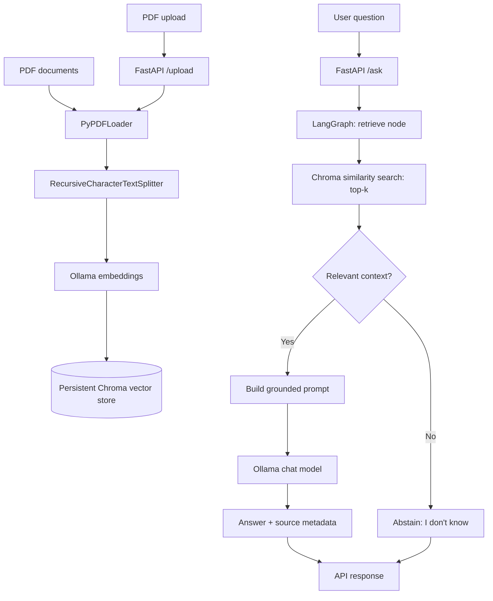

# AI & Computer Vision Knowledge Assistant (RAG)

A document-grounded question-answering assistant for AI and Computer Vision PDFs. It uses LangChain for document loading, text splitting, embeddings and retrieval; Chroma for persistent vector storage; Ollama for local embeddings and generation; LangGraph to coordinate retrieval, relevance checking and answer generation/abstention; and FastAPI for the backend API.

## Features

- Load and index PDF documents.
- Split extracted text into overlapping chunks.
- Generate embeddings and store chunks in a persistent Chroma collection.
- Retrieve the top-k relevant chunks for a question.
- Generate answers using retrieved context rather than relying on the model's general knowledge.
- Abstain when retrieved context is below the configured relevance threshold.
- Return source filenames, page numbers and text excerpts.
- Expose API endpoints for health checks, asking questions and uploading PDFs.

## Architecture



## Requirements

- Python 3.10 or a compatible version.
- Ollama installed and running.
- The Ollama models configured in `.env` available locally.
- Node.js/npm only if you are running the separate React website.
- Enough disk space for the PDFs and persistent Chroma index.

## Setup (backend)

Commands below assume you are in the project root.

1. Create and activate a virtual environment (use your existing environment if you already have one).

   **Windows PowerShell**
   ```powershell
   py -3.10 -m venv .venv
   .\.venv\Scripts\Activate.ps1
   ```

   **Linux / WSL**
   ```bash
   python3 -m venv .venv
   source .venv/bin/activate
   ```

2. Install Python dependencies:

   ```bash
   python -m pip install --upgrade pip
   pip install -r requirements.txt
   ```

3. Install/start Ollama and pull the models used in your `.env`. For the current project configuration, the model names are `qwen2.5:3b` and `nomic-embed-text`.

   ```bash
   ollama pull qwen2.5:3b
   ollama pull nomic-embed-text
   ollama list
   ```

4. Create `.env` from `.env.example` and adjust values if needed. Do not commit `.env`.

   ```env
   OLLAMA_BASE_URL=http://localhost:11434
   LLM_MODEL=qwen2.5:3b
   EMBEDDING_MODEL=nomic-embed-text
   ```

5. Put at least three PDF files in `data/` (the current project uses `computer_vision.pdf`, `deep_learning.pdf`, and `object_detection.pdf`).

6. Index the PDFs:

   ```bash
   python -m app.index_documents
   ```

   The vector index is stored in `chroma_db/` and reused between runs. If you change chunking settings or embedding models, consider rebuilding the index so the stored vectors remain consistent with the configuration.

7. Start the API:

   ```bash
   uvicorn app.main:app --reload
   ```

8. Open the interactive API documentation at `http://127.0.0.1:8000/docs`.

## API endpoints

| Method | Endpoint | Purpose |
|---|---|---|
| GET | `/health` | Check whether the API is running |
| POST | `/ask` | Ask a question; JSON body: `{"question": "What is object detection?"}` |
| POST | `/upload` | Upload and index a PDF using multipart form data, field name `file` |

The assignment brief also mentions an embeddings route. Confirm whether a dedicated `/embed` endpoint is required by your instructor and implement/document it if required; do not claim it exists unless it is present in the submitted source code.

## Run the React website (optional frontend)

The website is separate from the Python backend. From the `web/` directory:

```bash
npm install
npm run dev
```

The frontend environment file should point to the API:

```env
VITE_API_URL=http://127.0.0.1:8000
```

The FastAPI backend must be running at the same time. During local development, allow the Vite origin in FastAPI CORS settings. For deployment, configure the real frontend origin and host the backend, Ollama inference and persistent vector store appropriately.

## Run tests

From the project root, with the virtual environment activated:

```bash
python -m pytest -q
python -m compileall -q app tests
```

A successful compile check only verifies Python syntax. It does not prove that retrieval quality, answer correctness or citations are good; those must be evaluated with real questions.

## Evaluation procedure

Use `evaluation_template.csv` or `evaluation_questions.md` to test at least 10–15 questions. Include:
- Direct fact questions answerable from one document.
- Questions requiring information from more than one chunk.
- Questions that are not covered by the documents.
- Questions about source/page accuracy.
- Invalid or blank API requests.
- PDF upload and indexing.

Record the actual answer, expected answer, cited source/page, correctness, abstention behavior and notes. Report only observed results.

## Limitations

- Output quality depends on PDF text extraction, chunk size/overlap, embedding quality, retrieval ranking and the local LLM.
- Scanned/image-only PDFs may need OCR; the current text-based pipeline may not extract their content.
- The relevance threshold is a configurable heuristic and should be selected after testing rather than treated as a universal value.
- Returning source metadata makes verification easier, but it does not automatically guarantee every sentence in the generated answer is supported by a citation.
- The local Ollama setup is not automatically available to remote users. Public deployment requires hosting and securing the backend/model and persistent storage.

## Security and repository hygiene

- Never commit `.env`, credentials or private data.
- Add `data/uploads/` and local database/runtime files to `.gitignore` when they should not be submitted.
- Include the three source PDFs if their licences permit redistribution; otherwise provide a documented download script or links and instructions.
- Avoid exposing the upload/API service publicly without appropriate authentication, file-size limits and deployment security.

## Project report

Complete `report_template.pdf` after running the evaluation. The report contains blank evaluation rows intentionally; fill them with actual results before submission.
